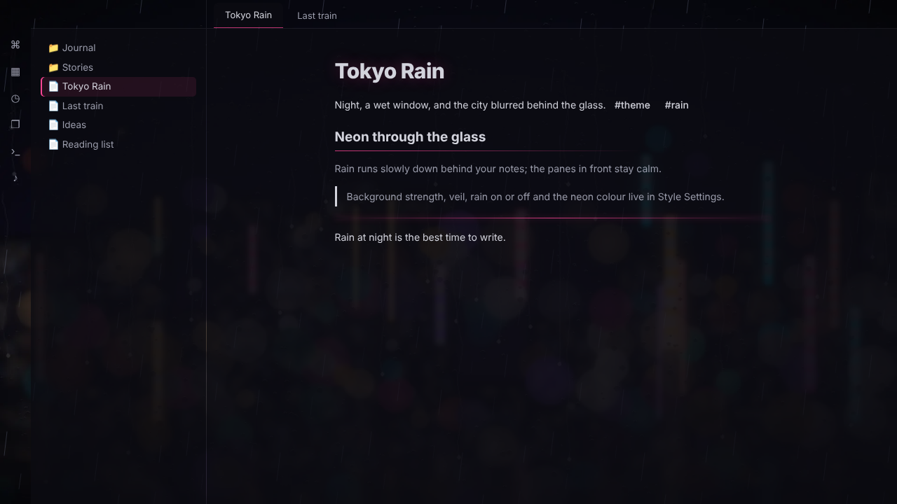
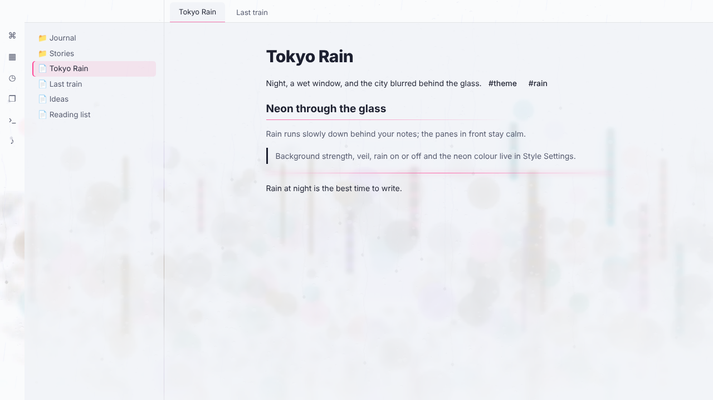

# Tokyo Rain

A dark, rainy-night theme for Obsidian. Your notes sit on calm panes in front of a wet window, with the city's neon blurred behind the glass and rain running slowly down it. The light mode turns the same scene into a misty grey morning.

## Features

- **The city behind the glass:** an original painted night scene (indigo sky, blurred neon and bokeh, a wet street) behind your workspace, softly veiled so text stays easy to read.
- **Falling rain:** slow, gentle streaks over the background. Switch it off any time with **Stop the rain** (also a command), and it stops by itself if your system asks for reduced motion.
- **Neon accents:** headings with a soft neon glow, a gradient underline under H2, outline tags, frosted-glass callouts with a neon edge, a neon-tube divider and a neon strip on the active file.
- **Light mode:** the same scene as a misty grey morning.

## Settings

With the [Style Settings](https://github.com/mgmeyers/obsidian-style-settings) plugin:

- **Background strength:** how strongly the city shows.
- **Veil strength:** how much the file list, notes and right sidebar quieten the city.
- **Stop the rain**
- **Solid note background:** a plain background behind the note you're writing.
- **Neon:** Pink (default), Cyan, Amber or Violet.

## Install

Settings → Appearance → Themes → **Manage**, search for **Tokyo Rain**, then **Install and use**.

## Credits

The background art is original, painted for this theme. No photos or third-party images are used.

## Support

If you enjoy it, you can [buy me a coffee](https://buymeacoffee.com/ashotis). Found a bug or have an idea? [Open an issue](https://github.com/AshOtis/Tokyo-Rain/issues). It's the best way to reach me, and every report gets read.

## Licence

[GNU AGPL v3 or later](LICENSE) © AshOtis
